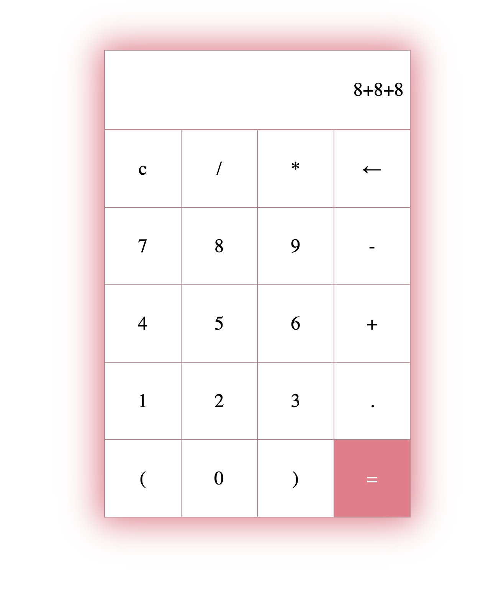

# Cute Calculator 🧮

A pink calculator you use in the browser by clicking the buttons.

## Description

This is a project I built to practice JavaScript events and working with the page. The calculator has number buttons, math operators, parentheses, a clear button, and a backspace button. When you click a button, it shows up in the display, and when you click **=** the page works out the answer. It uses plain HTML, CSS, and JavaScript, so there is no server to run.

## Screenshot

## Features

- Number buttons 0 to 9 and a decimal point
- Add (+), subtract (-), multiply (*), and divide (/)
- Parentheses, so you can do things like (2+3)*4
- **c** clears the whole display
- **←** deletes the last character
- **=** shows the answer, or "Error!" if the math doesn't work
- Buttons turn pink when you hover over them
- Pink glow around the calculator

## Tech Used

- HTML
- CSS (grid)
- JavaScript

## How to Use

This app doesn't need a server or an API key.

1. Download or clone the project.
2. Open `index.html` in your browser (or use the Live Server extension in VS Code).
3. Click the buttons to build a math problem, like 8+8+8.
4. Click **=** to see the answer.
5. Click **c** to start over, or **←** to fix a mistake.

**Please note:** the calculator uses JavaScript's `eval()` to do the math. That's fine here because only the buttons can add to the display, but `eval()` shouldn't be used on text typed in by visitors on a real website.

## How It Works

1. `main.js` grabs the display and all the buttons.
2. Each button listens for a click.
3. A `switch` checks which button was clicked. **c** empties the display, **←** removes the last character, and **=** works out the answer.
4. Every other button adds its symbol to the end of the display.
5. If the math can't be worked out (like `8++`), it shows "Error!" instead of breaking.

## What I Learned

- How to listen for clicks on many buttons with `forEach`/`map` and `addEventListener`
- How to use a `switch` to do a different thing for each button
- How to use `try`/`catch` to handle errors
- How to remove the last character with `.slice(0, -1)`
- How to lay out the buttons in a grid with CSS
- How to add a hover effect and a glowing `box-shadow`

VIEW APP HERE: https://calculator-max2.onrender.com

## Author

Maya Rose 🌹
